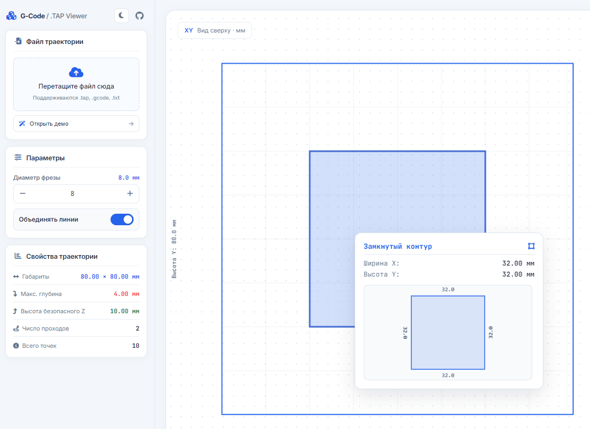

# G-Code & .TAP Viewer

Интерактивный веб-просмотрщик G-кода для файлов траекторий .tap, .gcode или .txt. Позволяет визуализировать траекторию инструмента, настраивать параметры фрезы и получать размеры готовых деталей.

Онлайн-версия доступна по ссылке: https://h412pj.github.io/G-code-viewer/

## Особенности

- Поддержка форматов .tap, .gcode, .txt.
- Визуализация проходов фрезы с цветовым разделением.
- Масштабирование (колесиком мыши или кнопками HUD) и панорамирование холста (перетаскивание левой кнопкой мыши).
- Настройка диаметра фрезы для точного расчета размеров готового изделия.
- Функция объединения коллинеарных линий для упрощения отображения траектории.
- Интерактивная подсветка проходов, отдельных сегментов и замкнутых контуров при наведении курсора.
- Всплывающее окно подсказки при наведении на замкнутый контур с автоматическим отображением реальных габаритов готовой детали (размер траектории минус диаметр фрезы).
- Боковая панель свойств траектории:
  - Габаритные размеры (X x Y)
  - Максимальная глубина реза
  - Высота безопасного Z
  - Количество проходов и точек траектории
- Демонстрационный режим для мгновенной проверки возможностей просмотрщика.

## Использование

1. Откройте онлайн-версию по адресу https://h412pj.github.io/G-code-viewer/ или запустите локальный файл index.html в любом современном браузере.
2. Перетащите файл траектории в зону загрузки или выберите его вручную.
3. Либо нажмите кнопку "Демонстрационный файл" для загрузки тестового контура.
4. Настройте диаметр фрезы в панели параметров.
5. Наведите курсор на элементы траектории для получения размеров готовой детали в интерактивном тултипе.

## Требования и установка

Приложение полностью клиентское, не требует серверной части и может быть запущено локально (просто откройте файл index.html) либо открыто по адресу https://h412pj.github.io/G-code-viewer/.
